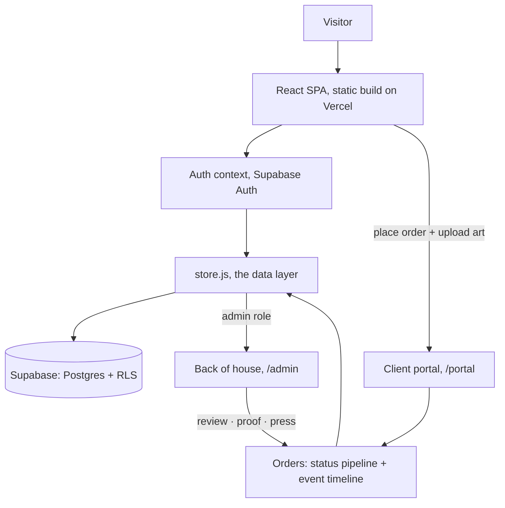

<p align="center">
  
</p>

<h1 align="center">Impressiva Printing</h1>

<p align="center">
  <b>Print Loud. Print Proud.</b>
</p>
<p align="center">
  A print-shop storefront with a client portal and an admin back office,<br />
  backed by Supabase.
</p>

<p align="center">
  
  
  
  
  
  
</p>

<br />

## Why Impressiva Printing

A print shop needs a storefront that looks as loud as its work, and a real system of record behind it. Impressiva is a single-page app that still ships as static files, but accounts, sessions, orders and artwork live in a Supabase project: Postgres behind row level security, with Supabase Auth handling login. Customers browse the catalog, then run real print jobs through a dedicated client portal, placing an order, uploading artwork and approving the proof, while staff work the same pipeline from a back-of-house admin panel, from any device.

<table role="presentation" width="100%">
  <tr>
    <td width="33%" valign="top">
      <h3 align="center">Real database</h3>
      <p align="center">Accounts, sessions, orders, and uploaded artwork live in Supabase, on Postgres with row level security, behind a single <code>store.js</code> data layer.</p>
    </td>
    <td width="33%" valign="top">
      <h3 align="center">Client portal</h3>
      <p align="center">Customers start jobs, upload print-ready art (PDF included), approve proofs, and follow every order through a real shop pipeline.</p>
    </td>
    <td width="33%" valign="top">
      <h3 align="center">Back of house</h3>
      <p align="center">A seeded admin preflights artwork, sends proofs, runs jobs to press, and manages the customer book, internal notes and all.</p>
    </td>
  </tr>
</table>

<br />

## Stack

| Layer             | Technology                                                                              |
| :---------------- | :-------------------------------------------------------------------------------------- |
| UI                | React 19 + React Router 7                                                               |
| Build & dev       | Vite 7                                                                                  |
| Styling           | Tailwind CSS 3, ink / paper surfaces with a `flare` red accent                          |
| Type              | Anton (display), Archivo (headings), Inter (body), Space Mono, all self-hosted          |
| Animation & icons | CSS keyframes in `tailwind.config.js`, scroll reveals via `Reveal.jsx` · `lucide-react` |
| Auth & database   | Supabase, email/password auth, Postgres with row level security                         |
| Hosting           | Vercel (SPA rewrites in `vercel.json`)                                                  |

## Getting started

Node 22 or newer.

```bash
npm install
npm run dev           # Vite dev server
npm run build         # production build to dist/
```

No environment configuration is required: the Supabase project URL and publishable key are baked into the build (they are public by design; row level security is the real boundary). To point a build at a different Supabase project, copy `.env.example` to `.env` and override `VITE_SUPABASE_URL` / `VITE_SUPABASE_PUBLISHABLE_KEY`.

### Scripts

| Script                 | Does                                |
| :--------------------- | :---------------------------------- |
| `npm run dev`          | Start the Vite dev server.          |
| `npm run build`        | Production build to `dist/`.        |
| `npm run preview`      | Serve the production build locally. |
| `npm run lint`         | Lint with ESLint.                   |
| `npm run format`       | Format `src/**` with Prettier.      |
| `npm run format:check` | Check formatting without writing.   |

## Routes

| Route                                  | Renders                                                                      |
| :------------------------------------- | :--------------------------------------------------------------------------- |
| `/`                                    | Hero, best sellers, categories, the rest of the catalog, recent work, social |
| `/products`                            | Full catalog, filterable to best sellers, each row expanding to its spec     |
| `/work`                                | Portfolio grid with category filters                                         |
| `/about`                               | Studio story, headline figures, milestone timeline, standards                |
| `/contact`                             | Studio phone, email, address and hours, plus an enquiry form                 |
| `/privacy` · `/terms`                  | Privacy notice and terms of service                                          |
| `/login` · `/signup`                   | Supabase email/password auth                                                 |
| `/forgot-password` · `/reset-password` | Self-serve password recovery over an emailed link                            |
| `/portal`                              | Client dashboard: action queue, stats, recent orders (protected)             |
| `/portal/orders`                       | Order history with filters                                                   |
| `/portal/orders/new`                   | Start a job: product, specs, quantity, artwork                               |
| `/portal/orders/:id`                   | Order detail: pipeline, artwork uploads, proof approval, activity            |
| `/portal/profile`                      | Contact details and password                                                 |
| `/admin`                               | Shop-floor dashboard: review queue, pipeline stats, activity (admin)         |
| `/admin/orders`                        | Every order with search + status filters                                     |
| `/admin/orders/:id`                    | Order workbench: artwork review, proofs, status actions                      |
| `/admin/customers`                     | Customer directory with search                                               |
| `/admin/customers/:id`                 | Customer detail: their orders, internal shop notes, removal                  |
| `/account`                             | Redirects into `/portal`                                                     |
| `*`                                    | Not found                                                                    |

The portal and admin panel render in their own sidebar shell, a dedicated site view with the storefront one click away.

## The order pipeline

Every job moves through the same pipeline the marketing site promises, with real hand-offs between the two panels:

```
Awaiting Artwork -> Artwork Review -> Proof Approval -> In Production -> Ready -> Completed
      (customer)        (shop)         (customer)        (shop)      (shop)
```

- Uploading artwork moves a job onto the shop's review desk automatically; removing the last file hands it back.
- The shop preflights files, then sends a proof, or requests new artwork with a reason the customer sees.
- The customer approves the proof (straight to press) or requests changes (back to review).
- Either side can leave notes on the order; everything lands on a per-order activity timeline.

## Architecture



## How it works

- **Supabase is the backend.** Login is Supabase email/password auth; profiles, orders, files and the activity timeline are Postgres tables reached through `store.js`, and the SQL for all of it lives in `supabase/migrations/`.
- **Row level security does the guarding.** Customers can only ever read and write their own profile and orders; staff see everything. Roles, order numbers and timestamps are server-assigned, so the browser cannot grant itself admin or forge a status.
- **The pipeline is enforced in the database.** A trigger limits customers to the moves the portal offers (upload art, cancel early, answer a proof); everything else is the shop's to make.
- **Orders are the unit of work.** Artwork always belongs to an order (`IMP-1042` style numbers from a database sequence), and every status change, upload, and note is logged to that order's timeline with its actor.
- **Uploads become data URLs.** Art is read client-side and stored with the order, capped at 4 MB per file, with type validation for PDF, PNG, JPEG, WEBP, SVG, and GIF.
- **Admins come from an allowlist.** Emails in the `admin_emails` table become staff accounts the moment they sign up, with no shipped passwords anywhere in the repo. Adding an admin is one SQL insert.
- **Protected routes are real.** `ProtectedRoute` gates `/portal` on a session and `/admin` on the admin role, re-resolved from the database, and the database enforces the same boundary regardless.
- **Accounts follow the customer.** Everything lives in the shop's database, so a customer can sign in from any device and staff see one shared book of business.
- **The first screen is in the document.** `index.html` carries the home page's head, its structured data, and a full text version of the first screen, so a crawler that runs no script still reads the studio, its products and its hours. The app replaces it on mount, and `RouteHead.jsx` rewrites the head on every navigation.
- **A stale tab repairs itself.** Route chunks carry content hashes, so a tab left open across a deploy asks for a filename the host no longer has. `chunk-recovery.js` wraps every dynamic import and reloads the page once per tab instead of dropping the visitor on an error screen.
- **Faults and traffic report themselves.** An inline reporter in `index.html` posts uncaught errors, rejections, failed resources and 5xx responses to the collector, and the analytics tracker attaches after the load event so nothing on the way to the first screen waits for it.

The enquiry form on `/contact` has no delivery route behind it yet: submitting swaps in the confirmation panel and nothing leaves the page. The phone number and email address beside it are the working routes.

### Accounts

Customers create their own accounts from **Sign up**. Where the Supabase project asks for email confirmation the app says so and waits for the link; otherwise the new account is signed in straight away. Staff sign up with an allowlisted email and come up as admins. Password resets are self-serve from the login page.

## Project structure

```
impressivaprinting-com/
├── index.html                 The home page head, its structured data, and the first screen
├── public/
│   ├── logo.png, og-card.png, favicon.svg, release.json
│   ├── apple-touch-icon.png, icon-192.png, icon-512.png, site.webmanifest
│   ├── robots.txt, sitemap.xml, llms.txt
│   ├── fonts/                 The four type families, self-hosted, Latin subset
│   ├── categories/            Catalog category imagery
│   └── work/                  Portfolio shots
├── scripts/
│   └── images.sh              Builds the WebP and AVIF derivatives of every photo
├── supabase/
│   └── migrations/            Schema, RLS policies, triggers: the backend as SQL
├── src/
│   ├── main.jsx               Browser entry
│   ├── index.css              Design tokens, Tailwind layers, keyframes
│   └── app/
│       ├── App.jsx            Route table: storefront, portal, admin
│       ├── components/        Nav, Footer, ProductPlate, WorkTile, Reveal, …
│       │   └── panel/         PanelShell, OrderStepper, EventTimeline, …
│       ├── views/             Home, Products, Work, About, Contact, …
│       │   ├── portal/        Client portal: dashboard, orders, profile
│       │   └── admin/         Back of house: dashboard, orders, customers
│       ├── context/           Auth context + provider (Supabase Auth)
│       ├── hooks/             useAuth, useStoreQuery, useHotkeys
│       ├── constants/         site.js, products.js, routes.js, orders.js, content.js, seo.js
│       ├── data/              supabaseClient.js + store.js (async data layer)
│       └── utils/             files.js (validation), format.js, chunk-recovery.js
└── vercel.json                SPA rewrites and asset cache headers
```

## License

Private project. All rights reserved.

<br />

<p align="center">
  <sub>Built by <a href="https://taylorurl.com">TaylorURL</a>, custom sites for local businesses.</sub>
</p>
